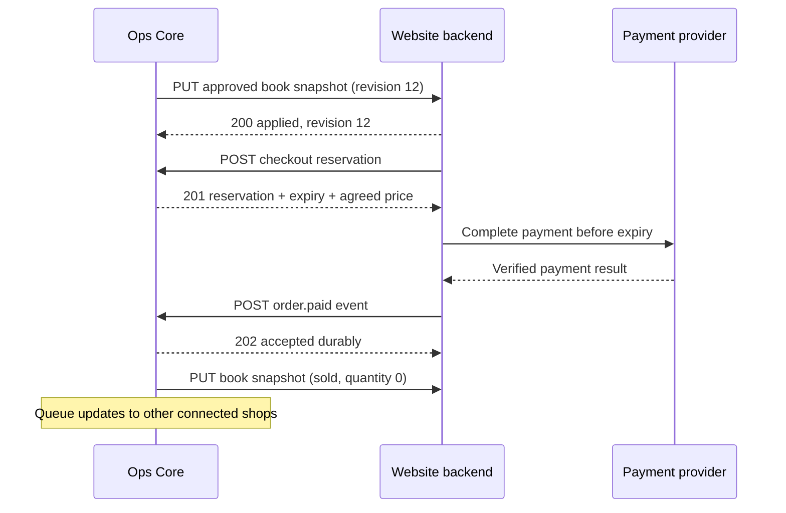

# Custom bookshop connection — v1 staging contract

Ops Core prepares and publishes books to the owner's custom website. The website displays those books, handles checkout, and reports sales back. Shopify is optional and is not part of this connection.

**Status: implemented locally, awaiting staging verification.** Ops Core now implements its versioned routes and signed publishing delivery. The real website receiver, deployment and remote marketplace stock updates still need end-to-end checks. See [staging setup](STAGING.md). Keep real payments disabled until those checks pass.

Start with [the Gemini handoff](GEMINI-HANDOFF.md). The machine-readable contract is [openapi.json](openapi.json); sample payloads are in [examples/](examples/).

## Ownership and direction

| Responsibility | Owner |
| --- | --- |
| Book SKU, catalogue details, online price, stock, collector holds, approval | Ops Core |
| Store design, navigation, public book pages, cart, payment provider, customer records | Custom website |
| Publishing delivery, retries, per-site publication status | Ops Core |
| Payment verification, durable sale-event delivery, customer communication | Custom website backend |

One SKU identifies **one physical copy**, not an ISBN or title. Two copies get two SKUs. v1 supports quantity 0 or 1, CAD only, and one website per connection. Credentials bind requests to a tenant and website; request bodies cannot choose a tenant.



The diagram describes the intended connected behavior; the actual website and marketplace deliveries are not yet staging-verified. All sale and hold paths must share the same atomic stock claim before this can prevent competing checkouts. A cached listing or a successful payment alone is not a stock guarantee.

## Endpoints

All endpoints are backend-to-backend over HTTPS. The browser talks to its own website backend and never receives integration credentials.

| Receiver | Method and path | Purpose |
| --- | --- | --- |
| Website | `PUT /api/ops-core/v1/books/{sku}` | Replace the public book snapshot, or withdraw it |
| Ops Core | `POST /api/integrations/custom-site/v1/reservations` | Atomically reserve every copy in a checkout |
| Ops Core | `POST /api/integrations/custom-site/v1/reservations/{reservation_id}/release` | Release an unpaid checkout reservation |
| Ops Core | `POST /api/integrations/custom-site/v1/order-events` | Record verified paid or cancelled orders |
| Ops Core | `GET /api/integrations/custom-site/v1/order-events/{event_id}` | Check durable processing and channel-sync state |

Base URLs are deployment configuration. Do not hardcode the existing public Vercel address or a particular client's name. No browser CORS exception is needed for this connection.

## Publish a book

Use the complete [book snapshot](examples/book.json). Ops Core assigns a positive, monotonically increasing `revision` per SKU and connection. Every content, price, stock, hold, or publication change increments it. Never use a timestamp as the revision.

- Upsert by SKU. Path SKU must equal body SKU. Never match by title or ISBN.
- Store the snapshot and revision in one transaction. Return 200 only once it is durable and the public view uses that revision (including cache invalidation).
- A lower revision returns 200 with `applied: false` and the stored revision; it must not restore old stock. An identical revision and identical body is a no-op. The same revision with different content returns 409.
- `publication: published` allows a page. `publication: unpublished` removes the public page and purchase controls. Unpublication is a persistent tombstone, not a hard delete; keep its revision so delayed requests cannot republish it.
- `availability: available` has `quantity: 1`. Held or sold has `quantity: 0`. Unpublished books also have quantity 0. Availability never bypasses publication.
- Full snapshots replace optional fields; null clears a value and an empty array clears a collection. Treat text as plain text, not executable HTML. New optional fields may be ignored.
- `images` contains public HTTPS URLs for actual copy photos with alt text. An empty array means no photo; use a neutral placeholder. Never invent a cover or expose temporary local/blob URLs.
- A repeatable full resync sends the latest snapshot for every previously published SKU, including withdrawal tombstones. Absence from a batch is not permission to delete a book.

Example reply:

```json
{"sku":"BK-EXAMPLE-001","revision":12,"applied":true}
```

Publish only reviewed book details and approved prices. Sale, hold, and withdrawal updates may automatically reduce availability under an explicitly enabled stock-protection policy. Do not wait for a content-review decision while leaving a sold copy purchasable.

## Checkout reservation

The website submits [reservation.json](examples/reservation.json) before starting payment. Use a stable `checkout_id`, a random stable event ID, and the exact displayed price. v1 allows at most 20 distinct SKUs per checkout, each with quantity 1. Duplicate SKUs are invalid.

Ops Core must atomically validate all items: published to this connection, available, not held for a collector, matching price, and eligible to sell online. Either reserve all items or return 409 without reserving any. Create a 15-minute reservation and return its ID, fixed UTC expiry, and agreed per-item prices. Existing catalogue status alone is insufficient; reservations need durable storage and atomic claims.

A retry with the same event ID/body returns the original result. A new event ID for the same checkout must find the existing reservation rather than create another or extend expiry. Reuse of a checkout ID with different items returns 409. The price is locked for this reservation; checkout tax, shipping, and payment-provider totals remain the website's responsibility.

The website must display the authoritative expiry, stop payment on expiry, and release on an abandoned checkout where possible. Ops Core expires claims using database time; correctness cannot depend on a cleanup cron running on time. A failed release leaves the claim until its original expiry. On an Ops Core outage, stop checkout and offer to try again; never fall back to cached stock.

Do not use the existing 48-hour collector/counter holds as checkout reservations. They serve different purposes.

## Paid and cancelled orders

The website verifies payment with its payment provider on the server. A browser redirect is not proof of payment. Persist an outbound event before sending it to Ops Core; retry from a durable outbox.

Send [order-paid.json](examples/order-paid.json) with the reservation ID, stable website order ID, exact SKUs and agreed unit prices. Do not send card details, addresses, customer notes, or payment secrets. Customer information stays on the website for v1; Ops Core fulfilment requiring an address is a separate future contract.

For `order.paid`, Ops Core atomically checks ownership, the active unexpired reservation, matching items and prices, and uniqueness of the website order. In the same transaction it consumes the reservation, marks the copies sold, stores the event and order linkage, and writes stock-update work to an outbox. Return 202 only after that commit. If payment arrives after expiry or the copies are no longer claimable, return 409 `reservation_expired` or `stock_conflict`; the website flags the order for staff resolution and must not promise fulfilment. Refund or void actions follow the website's explicit payment policy, not this API.

`order.cancelled` requires an existing paid order and exactly matching reservation/items. Record the cancellation once, but **do not automatically relist or refund**. Staff must confirm that the physical copy is sellable and approve relisting. Cancelling an unpaid checkout uses reservation release instead.

Deduplicate both by event ID and by `(connection, order_id, event_type)`. A repeated business event under a new ID returns the original canonical event ID; poll the ID in the receipt. A new ID cannot sell the same copy twice. Out-of-order cancellation for an unknown order returns 409 `order_not_found`; the website retries it after its paid event is accepted. A delayed paid event must never resurrect a cancelled order.

202 means “stored and queued,” not “every marketplace is updated.” Poll the event-status endpoint with backoff. `processing` means delivery remains pending; `completed` means all targeted channel updates succeeded; `needs_review` means a conflict or exhausted delivery needs staff attention. `channel_results` reports each target's state. Local sold state stays authoritative even when a remote marketplace is unavailable.

## Authentication, replay protection, and retries

Provision separate random keys for each direction, environment, and client connection. Key IDs resolve to a tenant, connection, allowed direction, and allowed operations. Store keys only in backend secret managers. An active connection and subscription are required. Rotate keys using a short overlap of key IDs; disabling a connection immediately rejects it.

Every request, including GET, carries:

```text
X-Ops-Key-Id: <configured key id>
X-Ops-Timestamp: <Unix seconds>
X-Ops-Event-Id: <UUID, stable for retries of a mutation>
X-Ops-Signature: sha256=<lowercase hex HMAC-SHA256>
Content-Type: application/json   # mutations only
```

The bytes signed are, in order, uppercase HTTP method, raw path (no host), timestamp, event ID, and raw body bytes, separated by a single newline. There is no trailing newline after the body. GET has an empty body. v1 has no query parameters; reject them. Path identifiers use unreserved ASCII characters only. Sign the exact path sent. Verify against the raw body before JSON parsing, using a constant-time comparison. Reject timestamps outside ±300 seconds and unknown/disabled keys with 401. Require HTTPS with certificate verification. Responses must use `Cache-Control: no-store`.

Store a body digest and committed response per connection, method, path, and event ID for at least 30 days. Conflicting body reuse returns 409 `idempotency_conflict`. Generate a fresh timestamp and signature for each retry, retaining the event ID and identical body. SKU revisions and order/reservation uniqueness remain durable beyond this retry window. Do not log signatures, keys, raw customer payloads, or payment metadata.

Retry connection failures, timeouts, 408, 429, and 5xx with jittered exponential backoff: about 2s, 10s, 30s, 2m, 10m, then hourly for up to 24 hours. Honor `Retry-After` when supplied. Never retry 400/401/403/404/409/413/422 blindly; show a useful staff error. Reconcile ambiguous timeouts using the same event ID; never invent a new order. After exhaustion keep the job visible for manual recovery.

Limit bodies to 256 KiB, reject non-JSON mutations and unknown event types, and rate-limit by connection (initial target 60 requests/minute). Error format:

```json
{"error":{"code":"stock_conflict","message":"A copy is no longer available.","retryable":false},"request_id":"req_example"}
```

Use 400 malformed JSON, 401 bad authentication, 403 disallowed connection/scope, 404 unknown resource, 409 state/revision/idempotency conflict, 413 oversized body, 422 schema validation, 429 rate limit, and 503 temporary service/storage failure. Never report success if durable writes failed.

## What exists in Ops Core today

These are local implementation facts, not deployment claims. See [STAGING.md](STAGING.md) for configuration and the release gates.

| Area | Local implementation | Remaining verification |
| --- | --- | --- |
| Public book data | Reviewed public snapshots, pinned catalogue digest, persistent metadata, monotonic revisions and withdrawal tombstones | Real copy images need durable HTTPS storage; verify the actual website mapping |
| Custom website publishing | Approved `publish_custom_site` review operation and signed HTTPS outbox sender | Connect the real website receiver and confirm its durable revision/cache behavior |
| Checkout | Signed v1 routes, transactionally stored reservations, order receipts, deduplication and status | Run the actual website against staging with payments disabled |
| Stock claims | Shared ledger for website checkout, collector holds and incoming sales; database guards prevent bypass through ordinary inventory writes | Remote marketplaces cannot participate in a cross-system database transaction; verify their notifications, delisters and conflict handling |
| Delivery status | Durable retry jobs, lease recovery, Retry-After handling and explicit `needs_review` outcomes | Existing marketplace adapters still include stubs/dry-run behavior; these cannot justify live checkout |
| Legacy prototype | Authenticated `/api/shop/holds` mutations; client-specific `/api/shop/catalog` output remains | Do not build the generic v1 connection around those prototype routes |

Do not expose operator tokens or use `/inventory`, `/reviews`, the generic `/webhooks/orders`, or the legacy hold endpoints directly from the client browser. The custom website's backend uses the signed v1 API.

## Build order and acceptance checks

1. **Gemini:** finish the website's signed receiver, durable SKU/revision storage, public book mapping, cache invalidation, and backend API client. Keep real checkout disabled.
2. **Ops Core:** the local routes, stock claims and publisher are implemented. Provision an isolated staging deployment, configure the connection and verify the remaining real marketplace adapters.
3. **Together:** exchange staging base URLs and key IDs through configuration; exchange secret values privately. Run the cases below against both actual backends before enabling real orders.

Required cases:

- Publish one copy, update its price, withdraw it, then replay an older available snapshot: it stays withdrawn.
- Replay identical snapshots and orders: no duplicate book, sale, reservation, or downstream job. Alter the body under the same ID: 409.
- Two concurrent checkouts for one SKU: exactly one reservation succeeds. A competing collector hold or another sale cannot also claim it.
- Multi-book checkout with one unavailable SKU: no partial reservation. Price mismatch: no payment begins.
- Expired reservation fails even if no cleanup task ran; a release cannot reopen a sold copy.
- Verified payment consumes the correct reservation once. Late payment, unknown cancellation, and conflicting items go to explicit resolution.
- A cancelled paid order stays unavailable until staff approve relisting.
- Website or marketplace outage preserves outbox jobs; restart and retry converge without stale stock restoration. 202 alone never shows “all shops updated.”
- Wrong client key, wrong direction, disabled connection, altered body, expired signature and invalid schema are rejected without mutation.
- Missing bibliographic fields and photos stay unknown/empty. No invented publisher, place, year, edition or copy photograph.
- No integration keys or private collector/customer data appear in browser bundles, public payloads or logs.

The JSON examples and schemas validate the data contract only. They do not demonstrate a running integration or safe live checkout.
